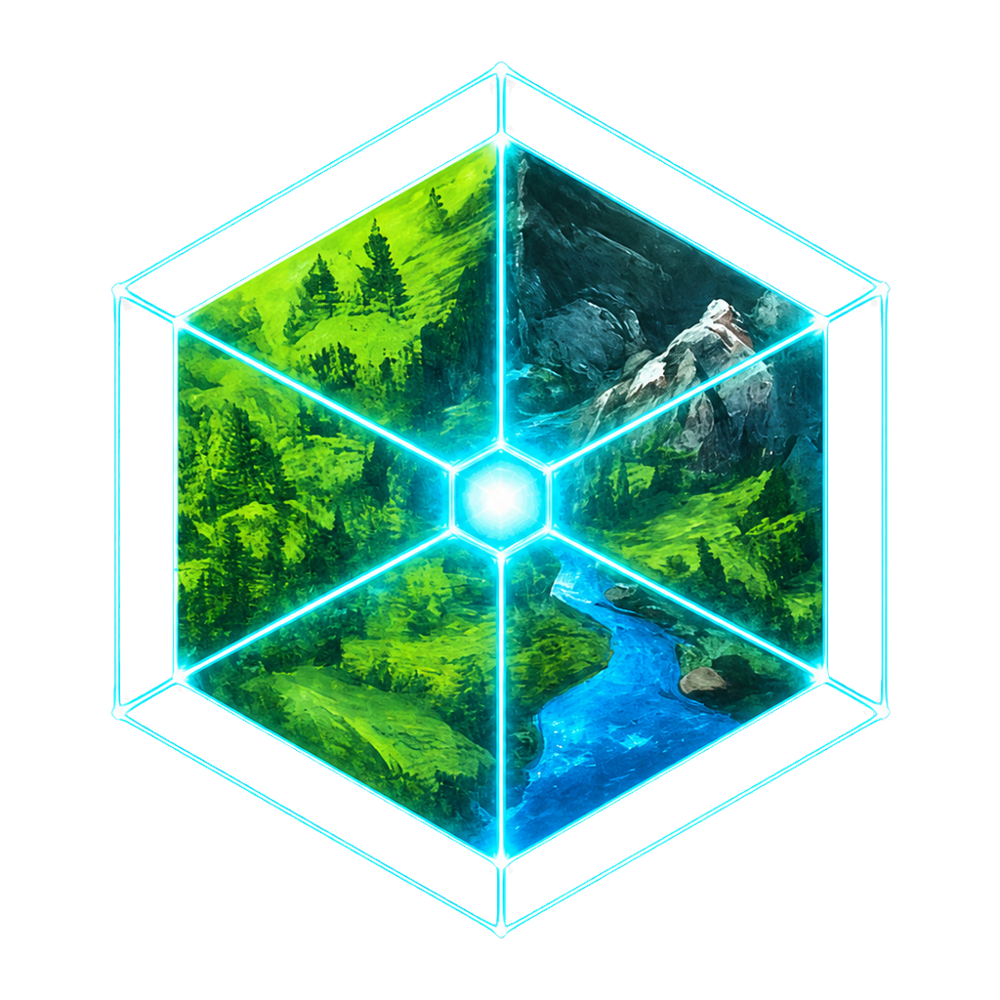

<div align="center">



# NexaMap Editor v2

**Modern object and map editor for Open Tibia clients — from classic `Tibia.dat` / `Tibia.spr` (including 32-bit `extended-items`) to Tibia 12+ assets.**

[](https://github.com/Mateuzkl/NexaMap-Editorv2)
-2563eb?style=for-the-badge)


[](LICENSE)

<br />

Based on **[OTS Creator](https://github.com/nekiro/ots-creator)** by **Marcin Jałocha (nekiro)** · Customized and maintained by **[Mateuzkl](https://github.com/Mateuzkl)**.

[Features](#features) ·
[Themes & Workspace](#themes--modern-workspace) ·
[Custom Server Converter](#custom-server-converter) ·
[Development](#development) ·
[Credits & License](#credits--license)

</div>

---

## Overview

**NexaMap Editor v2** combines the fast, multi-core **Go + Wails v3 + Svelte 5** engine of **OTS Creator** with a modern workspace experience inspired by NexaMap:

- Select your **Client folder** and **Server folder** once — `items.otb`, `items.xml`, `.otbm`/`.otmap` maps, monsters, and NPCs are detected automatically in read-only mode.
- Switch live between **Modern Dark**, **Modern Light**, and the original **Classic Tibia** interface without restarting.
- Edit **Objects**, **Sprites**, and **Maps** in the same app, with full WebGL rendering, live multiplayer collaboration, Market sharing, and built-in debug telemetry.

---

## Features

| Area | Highlights |
|---|---|
| **Clients** | Every `Tibia.dat` / `Tibia.spr` version, `.otfi` features, 32-bit `extended-items` (> 65,535 items), transparency, improved animations, frame groups, and Tibia 12+ `assets/` (`appearances.dat` + LZMA sheets). |
| **Object Editor** | Items, outfits, effects, missiles, animated live preview, bulk edit, sprite drawing, slicer, optimizer, pixel-based Compare & Merge, `.otobj` / `.obd` import & export. |
| **Map Editor** | Fast OTBM & git-friendly OTMAP support, ServerID / ClientID per-map safety, auto-border brushes, RME brush import, houses, spawns, towns, zones, waypoints, play mode, and live **Multiplayer**. |
| **Workspace** | Unified Client + Server cards, read-only resource validation, saved workspace profiles, one-click map launcher, and explicit confirmation before changing attached `items.otb`. |
| **Converters** | Built-in **Custom Server Converter** (ServerID → ClientID for `.otbm`/`.otmap`, `items.xml`, `items.otb`), Compile As version converter, and Object Viewer. |
| **Diagnostics** | Live **Debug Console** (`F12`), optional native Windows terminal (`--console`), real-time Go Heap / Sys / Goroutines / GC telemetry, **Force GC**, and optional `nexamap.log` file output. |
| **AI Agents (MCP)** | Opt-in local MCP server and headless `mcp` stdio mode so AI coding agents can inspect and edit maps alongside you. |

---

## Themes & Modern Workspace

Switch anytime from the top bar or **Settings → Appearance**:

- **Modern Dark** *(default for new installs)* — clean dark surfaces, collapsible sidebar, Client/Server cards, resource status chips, and full modern styling across editors and dialogs.
- **Modern Light** — dedicated high-contrast light theme (never distorts sprites or WebGL canvas).
- **Classic Tibia** — preserves the original OTS Creator textures, bevel frames, and pixel fonts 100% intact. Existing installations without a saved theme preference automatically stay on Classic until changed.
- **Text & UI Zoom (`80%`–`160%`)** — adjust font and interface scale live from the top bar (`−` / `100%` / `+`) or **Settings → Appearance**.

---

## Custom Server Converter

Available in **Workspace → Converters**:

1. Pick a **Source Server Folder** (containing `items.otb`, `items.xml`, and `.otbm`/`.otmap` maps) and a separate **Output Folder**.
2. Click **Analyze Server** to validate `items.otb` mappings and detect any duplicate `ClientID` collisions.
3. Click **Convert to ClientID** to generate converted maps, `items.xml`, and `items.otb` in the output folder — **source files are never overwritten**.

---

## Development

**Requirements:** Go 1.26+, Node 22+, and [`wails3`](https://v3.wails.io) CLI (`go install github.com/wailsapp/wails/v3/cmd/wails3@latest`).
On Linux, also install a C compiler and GTK 4 / WebKitGTK 6.0 headers (`build-essential pkg-config libgtk-4-dev libwebkitgtk-6.0-dev`).

```sh
wails3 task dev        # run with hot reload
wails3 task build      # production build into bin/
wails3 task test       # Go + frontend unit tests
```

Launch with a native Windows debug terminal attached:

```sh
.\bin\otscreator.exe --console
```

---

## Credits & License

- **Original Project & Core Engine:** [OTS Creator](https://github.com/nekiro/ots-creator) — **Copyright © 2026 Marcin Jałocha (nekiro)**.
- **License:** Apache License 2.0 with the Commons Clause (see [LICENSE](LICENSE) and [NOTICE](NOTICE)). Free to use, modify, and share; not for sale. Derived works must keep all original copyright notices and credits.
- Classic UI graphics and pixel fonts belong to their respective owners (see [NOTICE](NOTICE)).
